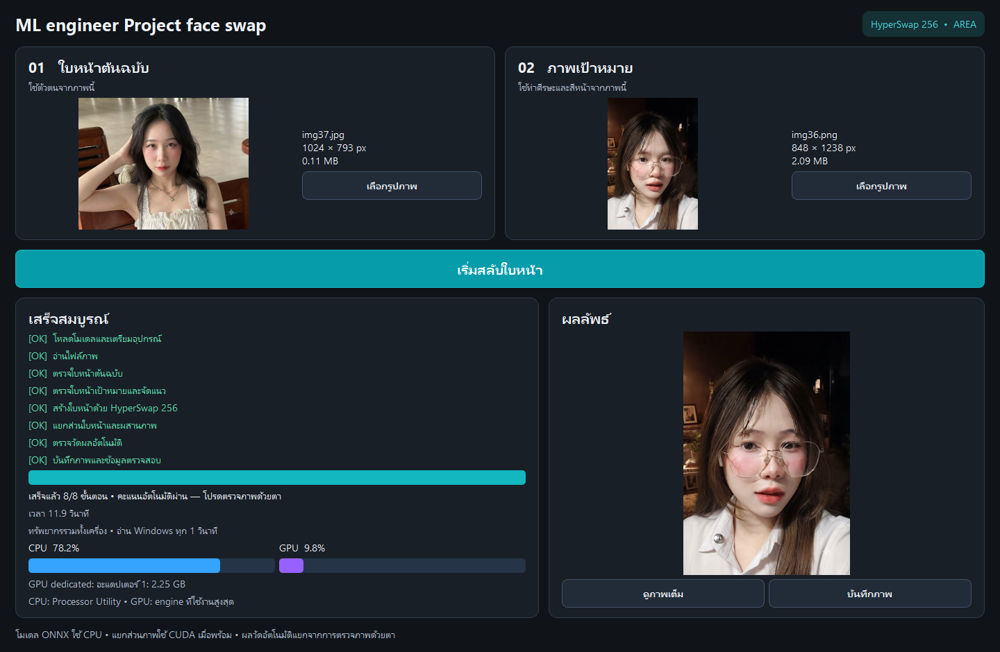
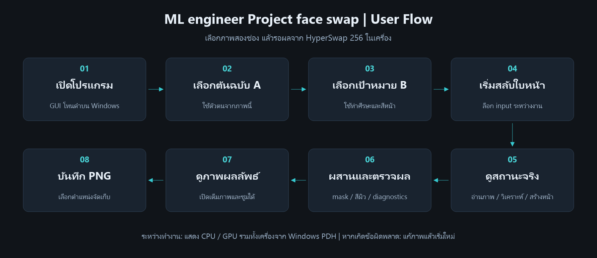
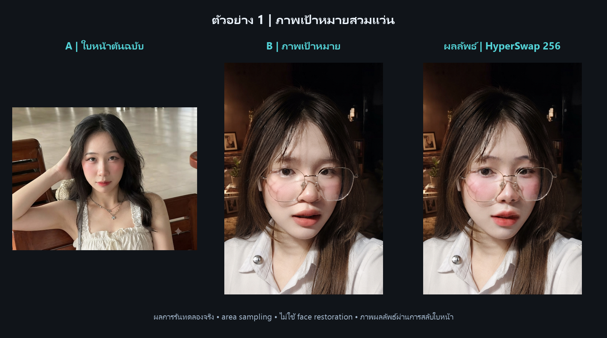
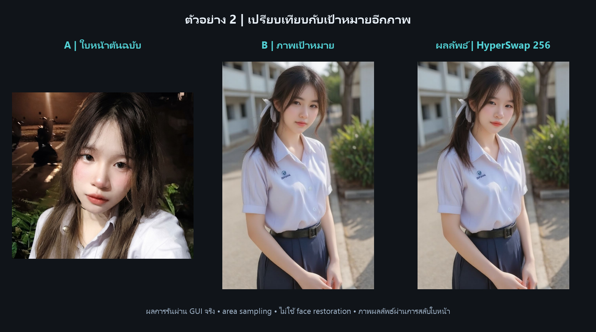
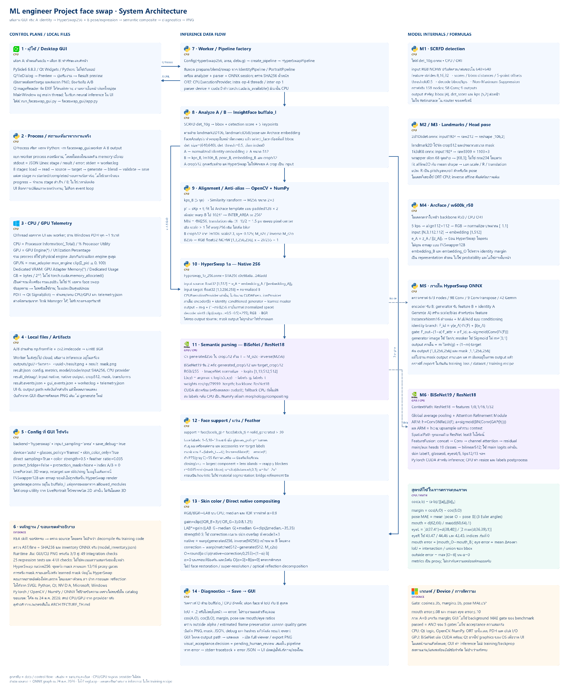

# ML engineer Project face swap

**โปรแกรมสลับใบหน้าผ่าน GUI ภาษาไทยบน Windows ด้วย HyperSwap 256**

เลือกภาพต้นฉบับ **A** เพื่อใช้ตัวตน และภาพเป้าหมาย **B** เพื่อใช้ท่าศีรษะ สีหน้า และองค์ประกอบภาพ จากนั้นกดเริ่มสลับใบหน้า ดูผล และบันทึกเป็น PNG ได้ในหน้าจอเดียว

โปรเจคนี้พัฒนาต่อยอดจาก [LivePortrait ของ Kuaishou / KwaiVGI](https://github.com/KwaiVGI/LivePortrait) โดยเพิ่ม GUI โทนดำ, HyperSwap backend, การลด alias จากการย่อภาพ, การผสานแบบคำนึงถึงแว่น/สีผิว และข้อมูลตรวจสอบผล โดยใช้ Algorithm และเทคนิคหลักดังนี้:

- **Face Detection, Landmarks และ Identity Embedding:** ใช้ InsightFace ตรวจใบหน้า หาจุดอ้างอิง และสกัดเวกเตอร์ ArcFace 512 มิติจาก A เพื่อส่งให้ HyperSwap 1a สร้างใบหน้าที่ความละเอียด native 256×256 โดยรับท่าศีรษะและสีหน้าจาก B
- **Similarity Alignment และ Anti-aliasing:** จัดแนวใบหน้าด้วย similarity transform ก่อนเข้าโมเดล เมื่อย่อภาพในโหมด `area` จะใช้ supersampling 4 เท่าแล้วลดขนาดด้วย `INTER_AREA` พร้อมชดเชยตำแหน่งศูนย์กลางพิกเซล เพื่อลด alias โดยรักษาพิกัดให้ตรงกัน
- **Semantic Segmentation และ Glasses-aware Mask:** ใช้ BiSeNet–ResNet18 แยกส่วนใบหน้า แล้วใช้ morphological erosion/dilation ประมาณแนวกรอบแว่นเพื่อช่วยรักษาแว่นจาก B โดย mask นี้เป็นการประมาณและยังมีข้อจำกัดกับกรอบบางหรือแสงสะท้อน
- **Skin-only LAB Color Matching:** ปรับสีใน LAB ด้วย median และ interquartile range ของบริเวณผิว แล้วจำกัดการปรับไว้เฉพาะผิว เพื่อลดผลกระทบต่อสีตา ฟัน และริมฝีปาก
- **Smoothstep Feathering และ Direct Compositing:** ใช้ distance transform และ smoothstep ทำขอบ mask ให้นุ่ม ก่อนนำภาพ native256 กลับไปผสานกับ B โดยตรงเพื่อลดการ resample ซ้ำ
- **Diagnostics และการประเมินผล:** บันทึก config, model hash, mask และภาพระหว่างขั้นตอน พร้อมคำนวณ cosine similarity ของ face embedding และตรวจท่าศีรษะ/landmarks โดยแยกคะแนนอัตโนมัติออกจากการยอมรับคุณภาพภาพด้วยตา

โค้ดส่วนต่อยอดดูแลโดย [Zypher00X](https://github.com/Zypher00X) โมเดล pretrained เป็นผลงานของเจ้าของโมเดลที่ให้เครดิตด้านล่าง

## หน้าตาโปรแกรม



*ภาพหน้าจอจากโปรแกรมจริง ไม่ใช่ภาพ mockup*

- ช่องเลือกภาพต้นฉบับและเป้าหมาย พร้อมภาพตัวอย่าง
- สถานะภาษาไทยอิงขั้นตอนประมวลผลจริง และแถบนับขั้นตอนที่สำเร็จ
- ตัวเลข/แถบ CPU และ GPU รวมทั้งเครื่องจาก Windows Performance Counters
- เปิดผลลัพธ์เต็มภาพ ซูม และส่งออก PNG
- แยก worker process เพื่อให้ GUI ยังตอบสนองระหว่างทำงาน

## User Flow



1. เปิดโปรแกรม แล้วเลือกภาพ A และ B ที่เห็นใบหน้าชัดเจน
2. กด **เริ่มสลับใบหน้า** โปรแกรมอ่านภาพ ตรวจใบหน้า จัดแนว และสร้างหน้าด้วย HyperSwap 256
3. ระบบแยกส่วนใบหน้า ประมาณ mask กรอบแว่น ปรับสีผิว และผสานกลับเข้า B
4. ตรวจผลอัตโนมัติและแสดงภาพ สามารถกด **ดูภาพเต็ม** และ **บันทึกภาพ** ได้

หากไม่พบใบหน้าหรือประมวลผลไม่สำเร็จ โปรแกรมจะแสดงข้อผิดพลาดและให้เลือกภาพ/ลองใหม่ โดยไม่แสดงผลเก่าเป็นผลของงานใหม่

## ตัวอย่างการสลับใบหน้า

แต่ละแถวแสดง **A ต้นฉบับ → B เป้าหมาย → ผลลัพธ์ HyperSwap 256** เป็นผลการรันทดลองจริงด้วย `input_sampling=area` ไม่ใช้ face restoration เพิ่มความคมภายหลัง ภาพคอลัมน์ขวาเป็นภาพที่ผ่านการสลับใบหน้าแล้ว

### ตัวอย่างที่ 1 — เป้าหมายสวมแว่น



### ตัวอย่างที่ 2 — เปรียบเทียบกับเป้าหมายอีกภาพ



ตัวอย่างแสดงพฤติกรรมของรุ่นทดลอง ไม่ใช่การรับรองความแม่นยำทุกภาพ โดยเฉพาะกรอบบาง สะพานแว่น แสงสะท้อน และรายละเอียดตา/ปากยังมีข้อจำกัด

## โมเดลที่ใช้

| โมเดล / น้ำหนัก | ใช้ทำอะไร | อุปกรณ์ที่โค้ดเลือก |
|---|---|---|
| **HyperSwap 1a 256** — `hyperswap_1a_256.onnx` | สร้างใบหน้าจาก identity ของ A และภาพใบหน้า B ที่ความละเอียด native 256×256 | ONNX Runtime **CPU** |
| **SCRFD** — `det_10g.onnx` | ตรวจตำแหน่งใบหน้าและ 5 keypoints | ONNX Runtime **CPU** |
| **2D106** — `2d106det.onnx` | หาจุดใบหน้า 106 จุดสำหรับจัด crop และขนาด mask | ONNX Runtime **CPU** |
| **3D68** — `1k3d68.onnx` | ประมาณจุดใบหน้าและท่าศีรษะสำหรับตรวจผล | ONNX Runtime **CPU** |
| **ArcFace R50** — `w600k_r50.onnx` | สกัด identity embedding 512 มิติ และใช้วัด similarity | ONNX Runtime **CPU** |
| **BiSeNet19 / ResNet18** — `79999_iter.pth` | แยกผิว ตา ปาก แว่น ผม และส่วนประกอบใบหน้า | PyTorch **CUDA เมื่อพร้อม / CPU fallback** |

SCRFD, 2D106, 3D68 และ ArcFace อยู่ในแพ็กเกจ **InsightFace buffalo_l** ส่วน ResNet18 เป็น backbone ของ BiSeNet เส้นทาง GUI ปัจจุบันใช้ HyperSwap แทนการเรียก LivePortrait 3D animation

## เทคโนโลยีและแนวทางประมวลผล

| เทคโนโลยี | บทบาท |
|---|---|
| Python + PySide6 / Qt Widgets | GUI, เลือกไฟล์, preview และ viewer |
| QProcess + JSON Lines | สื่อสารสถานะระหว่าง GUI และ worker |
| PyTorch / torchvision | BiSeNet inference และ backbone |
| ONNX Runtime + InsightFace | HyperSwap, detection, landmarks และ recognition |
| OpenCV + NumPy + scikit-image | alignment, area sampling, morphology, LAB และ alpha compositing |
| ctypes + Windows PDH + QThread | อ่าน CPU/GPU/dedicated memory แยกจากงานสร้างภาพ |
| PNG + JSON | บันทึกผล mask, config, hash, diagnostics และ debug |

Pipeline ใช้ similarity alignment, การย่อแบบ supersampling/INTER_AREA, semantic mask, smoothstep feather และการปรับ LAB เฉพาะผิว จากนั้น sample ภาพ native256 กลับเข้า B โดยตรงเพื่อลดการ resample ซ้ำ

**CPU/GPU ที่แสดงเป็นการใช้รวมทั้งเครื่อง ไม่ใช่เฉพาะโปรแกรมนี้** และอาจต่างจาก Task Manager ในแต่ละจังหวะสุ่ม แม้เครื่องมี CUDA ก็ไม่ได้หมายความว่า HyperSwap รัน GPU: provider ที่โค้ดเลือกสำหรับ ONNX ยังเป็น CPU

## System Architecture

[](https://canva.link/tfb5d0uwtqyd5dz)

**[เปิดแผนภาพฉบับละเอียดบน Canva Whiteboard](https://canva.link/tfb5d0uwtqyd5dz)** — 21 บล็อก ครอบคลุม GUI/worker, การเชื่อมโมเดล, tensor shapes, สูตร mask/สี/คะแนน และตำแหน่ง CPU/GPU ใช้โลโก้เทคโนโลยีจาก [SVGL](https://svgl.app/)

HyperSwap มี learned mask ที่ผสมภาพกับ B **ภายในโมเดลอยู่แล้ว** ก่อนส่ง output ออกมา จากนั้นโปรเจคจึงผสมด้วย semantic mask อีกชั้นหนึ่ง จึงควรแยกสองส่วนนี้เมื่อวิเคราะห์คุณภาพ

## เริ่มใช้งานบน Windows

โปรแกรมยังใช้ Python environment และน้ำหนักโมเดลแยก ไม่ใช่ standalone EXE และไม่รวม `venv`, `.onnx`, `.pth` หรือรูปทดสอบต้นฉบับไว้ใน repository นี้

สำหรับเครื่องที่จัดเตรียม ML environment และโมเดลครบแล้ว รันจากโฟลเดอร์โปรเจค:

```powershell
.\venv\Scripts\python.exe -m pip install -r requirements_gui.txt
.\venv\Scripts\python.exe run_faceswap_gui.py
```

หรือดับเบิลคลิก **`เปิดโปรแกรม Face Swap.bat`** อ่านวิธีใช้เพิ่มเติมที่ [คู่มือ GUI](faceswap_gui/README.md)

### น้ำหนักที่ต้องเตรียม

| รายการ | ตำแหน่ง / แหล่งที่มา |
|---|---|
| HyperSwap 1a 256 | `pretrained_weights/hyperswap/hyperswap_1a_256.onnx` จาก [FaceFusion assets](https://github.com/facefusion/facefusion-assets/releases/tag/models-3.3.0) |
| buffalo_l 4 โมเดลข้างต้น | `%USERPROFILE%/.insightface/models/buffalo_l/` จาก [InsightFace model zoo](https://github.com/deepinsight/insightface/tree/master/python-package#model-zoo) |
| BiSeNet parser | `res/cp/79999_iter.pth` จาก [face-parsing.PyTorch](https://github.com/zllrunning/face-parsing.PyTorch#training) |
| ResNet18 backbone cache | `checkpoints/resnet18-5c106cde.pth` ภายใต้ cache ที่ `torch.hub.get_dir()` คืนค่า |

ดาวน์โหลด HyperSwap พร้อมตรวจ hash และบันทึก metadata:

```powershell
.\venv\Scripts\python.exe experiments/round3_20261024/download_candidate.py
```

เครื่องใหม่ต้องติดตั้ง PyTorch/torchvision, ONNX Runtime, InsightFace และ dependencies ของ pipeline เพิ่มด้วย `requirements_gui.txt` ติดตั้งเฉพาะส่วน GUI ไม่ใช่ตัวติดตั้ง ML environment ทั้งหมด

### ทดสอบผ่าน CLI แบบเดียวกับ GUI

```powershell
.\venv\Scripts\python.exe run_3d_faceswap.py -s "path/to/source.jpg" -t "path/to/target.jpg" -o "outputs/result.png" --backend hyperswap --input-sampling area --debug
```

ผลจาก GUI เก็บใน `outputs/gui/<วันเวลา>_<รหัสงาน>/` มี PNG, JSON, mask, debug และ log สำหรับตรวจย้อนหลัง

## การทดสอบและขอบเขต

```powershell
.\venv\Scripts\python.exe -m unittest discover -s tests -v
```

ผลตรวจ ณ 24 ต.ค. 2026: unit/regression ผ่าน **25/25**, GUI integration checks **49/49** และภาพ GUI ตรงกับ CLI ทั้ง **3 คู่ที่ทดสอบ** เมื่อใช้ config เดียวกัน ข้อมูลนี้ยืนยันการทำงานของโปรแกรม ไม่ใช่ความสมจริงหรือความแม่นยำของตัวตนในภาพทั้งหมด

JSON แยก `quality.project_gate_pass` ออกจาก `visual_acceptance` ที่ยังต้องให้คนตรวจ ค่าความคล้ายไม่ใช่เปอร์เซ็นต์ความแม่นยำ GUI รุ่นนี้เลือกใบหน้าที่มีพื้นที่มากที่สุด และยังไม่รองรับเลือกบุคคลจากภาพหลายคนบนหน้าจอ

## เครดิตและสิทธิ์การใช้งาน

| เจ้าของผลงาน / โปรเจค | ส่วนที่นำมาใช้หรือต่อยอด |
|---|---|
| [Kuaishou / KwaiVGI — LivePortrait](https://github.com/KwaiVGI/LivePortrait) | repository ต้นทางและ utility จัด crop/พิกัด |
| [Henry Ruhs / FaceFusion Labs — HyperSwap](https://github.com/facefusion/facefusion-labs/tree/master/hyperswap) | โมเดลสลับใบหน้า HyperSwap; [ResearchRAIL-MS](https://github.com/facefusion/facefusion-labs/blob/master/hyperswap/LICENSE.md) |
| [DeepInsight — InsightFace](https://github.com/deepinsight/insightface) | SCRFD, landmarks และ ArcFace/buffalo_l |
| [zllrunning — face-parsing.PyTorch](https://github.com/zllrunning/face-parsing.PyTorch) และ [ทีม BiSeNet](https://github.com/CoinCheung/BiSeNet) | implementation/น้ำหนัก face parser และแนวทาง BiSeNet |
| [PyTorch / torchvision](https://pytorch.org/) | framework และ ResNet18 backbone |
| [Qt for Python](https://www.qt.io/qt-for-python), [OpenCV](https://opencv.org/), [NumPy](https://numpy.org/), [ONNX Runtime](https://onnxruntime.ai/) | เทคโนโลยีหลักของโปรแกรม |

คง [LICENSE ของ repository ต้นทาง](LICENSE) ไว้ น้ำหนักโมเดลมีเงื่อนไขแยกจาก license ของโค้ด โดย [InsightFace ระบุข้อจำกัดของ pretrained models สำหรับงานวิจัยที่ไม่ใช่เชิงพาณิชย์](https://github.com/deepinsight/insightface#license) และ HyperSwap ใช้ ResearchRAIL-MS ควรตรวจเงื่อนไขจากเจ้าของแต่ละส่วนก่อนนำไปใช้งานหรือแจกจ่าย

ใช้ภาพที่มีสิทธิ์และได้รับความยินยอมจากเจ้าของภาพ ระบุเมื่อเผยแพร่ว่าเป็นภาพที่ผ่านการสลับใบหน้า
